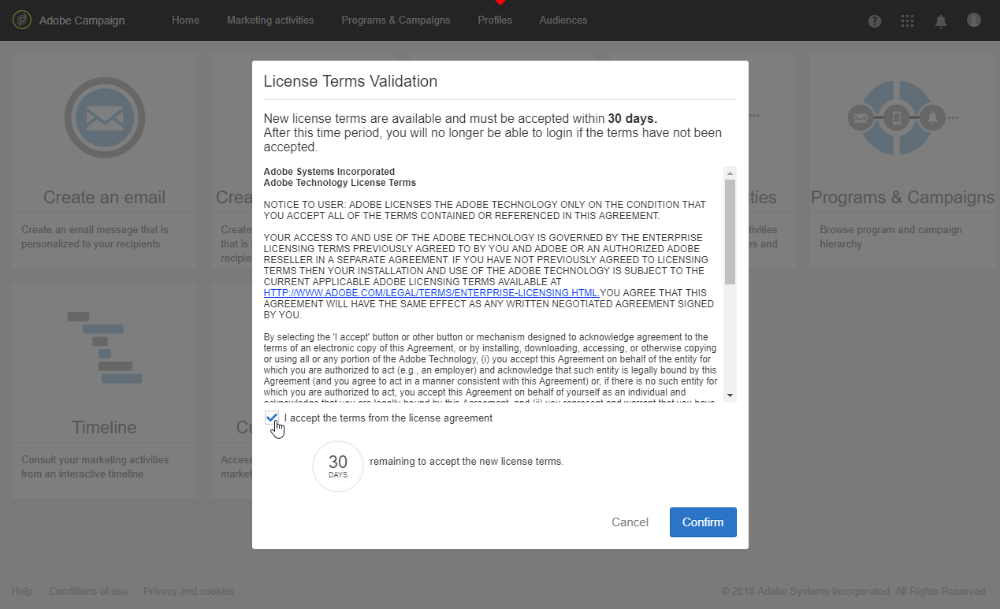

# 许可证{#licenses}

**[!UICONTROL Licenses]**&#x200B;窗口允许您查看实例上安装的许可证以及有关该许可证的不同信息，如内部版本号、版本版本或协议条款是否已被接受以及接受者。

使用新的内部版本或新功能时，许可条款可能会发生更改，并且必须由实例的功能管理员接受。

标准用户登录后将显示以下窗口，用户无需执行任何操作。 通过单击&#x200B;**[!UICONTROL OK]**&#x200B;按钮，他们仍可在Adobe Campaign上工作。

管理员必须在版本安装后的30天内通过选中&#x200B;**[!UICONTROL I accept the terms from the license agreement]**&#x200B;并单击&#x200B;**[!UICONTROL Confirm]**&#x200B;阅读并确认新的协议条款。

如果在这30天内未接受协议，则任何用户都将无法使用此实例。 标准用户将无法访问Adobe Campaign的功能，并且在功能管理员接受协议条款之前，将只能看到以下消息。

