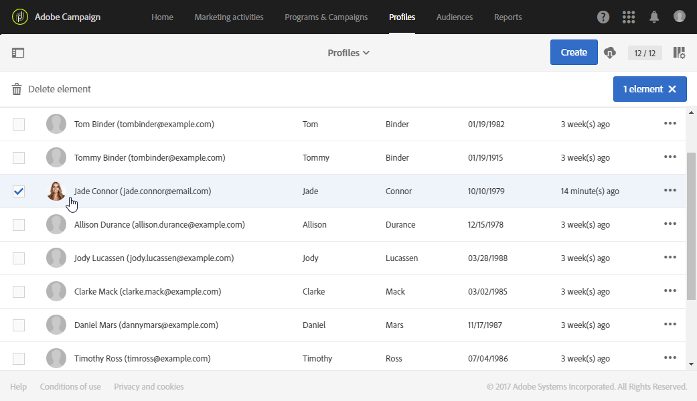

# Integrated Customer Profile{#integrated-customer-profile}

可以为您数据库中的每个联系人提供整合的客户轮廓。 此营销历史可将与客户联系有关的所有相关营销信息，合并到一个视图中。 然后，您即可在一个中心位置访问所有数字行为、线上和线下交易：联系信息、收到的电子邮件、跟踪日志、订阅和退订等。

要访问整合的客户轮廓，请执行以下步骤：

1. 从Adobe Campaign主页中，单击&#x200B;**[!UICONTROL Customer profiles]**&#x200B;卡或&#x200B;**配置文件**&#x200B;选项卡以显示配置文件列表。

1. 要根据特定字段搜索配置文件，请打开搜索窗格，然后选择要执行搜索的字段。

   

1. 指定要搜索的值，然后按Enter。

   >[!NOTE]
   >
   >请注意，可以根据电子邮件、名字和姓氏字段以及在扩展资源时添加的自定义字段执行搜索。
   >
   >搜索区分大小写，并且只对前缀执行。 例如，您将无法使用用户档案的姓氏查找用户档案。

1. 选择联系人以打开其用户档案。

   

然后，您可以访问此联系人的&#x200B;**营销历史**。

本页会收集关于轮廓的重要信息以及事件列表。

单击列表中的事件以将其打开：您可以访问已发送的消息或用户档案已订阅的服务。

>[!NOTE]
>
>营销历史也可使用 Adobe Campaign Standard API 访问。 有关更多信息，请参阅[专用文档](../../api/using/interacting-with-marketing-history.md)。
