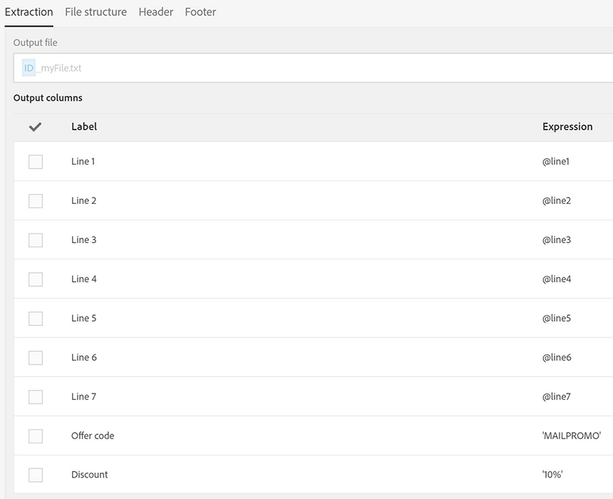

# 耦合电子邮件和直邮投放 {#coupling-email-direct-mail}

作为营销人员，您可能希望通过直邮发送产品目录。 在纸质产品目录中，某些页面提供了用于在网站购买产品时享受 10% 折扣的促销代码和链接。

线下和线上的结合非常有用，因为有些客户虽然喜欢在线订购，但更倾向于通过纸质产品目录查看产品建议。

下方提供了一个直邮模板示例供您参考。

下方展示了将直邮与电子邮件渠道结合使用的工作流示例。

**相关主题：**

* [直邮投放活动](../../automating/using/direct-mail-delivery.md)
* [关于直邮](../../channels/using/about-direct-mail.md)
