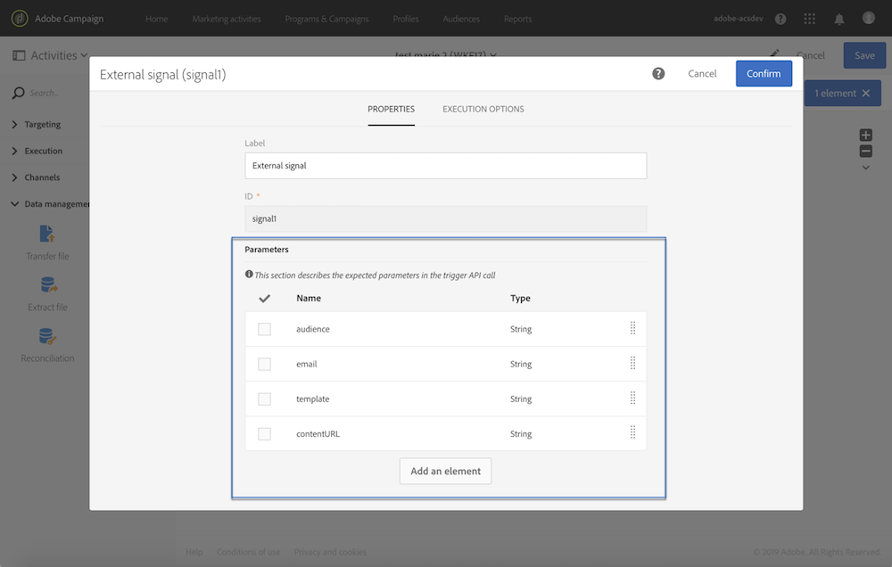

# 声明外部信号活动中的参数 {#declaring-the-parameters-in-the-external-signal-activity}

使用参数调用工作流的第一个步骤是在&#x200B;**[!UICONTROL External signal]**&#x200B;活动中声明它们。

1. 打开&#x200B;**[!UICONTROL External signal]**&#x200B;活动，然后选择&#x200B;**[!UICONTROL Parameters]**&#x200B;选项卡。
1. 单击&#x200B;**[!UICONTROL Create element]**&#x200B;按钮，然后指定每个参数的名称和类型。

   >[!CAUTION]
   >
   >确保参数的名称和数量与调用工作流时定义的参数相同（请参阅[此页面](../../automating/using/defining-parameters-calling-workflow.md)）。 此外，参数的类型必须与预期值一致。

   

1. 声明参数后，请完成工作流配置，然后运行它。
