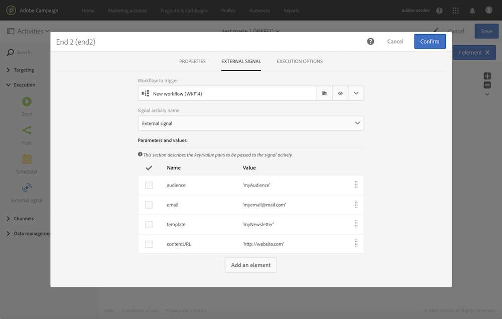

# 在调用工作流时定义参数 {#defining-the-parameters-when-calling-the-workflow}

本节详细介绍在调用工作流时如何定义参数。 有关如何通过API调用执行此操作的更多信息，请参阅[REST API文档](../../api/using/triggering-a-signal-activity.md)。

在定义参数之前，请确保：

* 已在&#x200B;**[!UICONTROL External Signal]**&#x200B;活动中声明了参数。 请参阅[此页](../../automating/using/declaring-parameters-external-signal.md)。
* 包含信号活动的工作流正在运行。

要配置&#x200B;**[!UICONTROL End]**&#x200B;活动，请执行以下步骤：

1. 打开&#x200B;**[!UICONTROL End]**&#x200B;活动，然后选择&#x200B;**[!UICONTROL External signal]**&#x200B;选项卡。
1. 选择要调用的工作流和外部信号活动。
1. 单击&#x200B;**[!UICONTROL Create element]**&#x200B;按钮以添加参数，然后填写其名称和值。

   * **[!UICONTROL Name]**：已在&#x200B;**[!UICONTROL External signal]**&#x200B;活动中声明的名称（请参阅[此页面](../../automating/using/declaring-parameters-external-signal.md)）。
   * **[!UICONTROL Value]**：要分配给参数的值。 该值应遵循[此部分](../../automating/using/advanced-expression-editing.md#standard-syntax)中描述的&#x200B;**标准语法**。

   

   >[!CAUTION]
   >
   >确保已在&#x200B;**[!UICONTROL External signal]**&#x200B;活动中声明了所有的参数。 否则，运行活动时将出错。

1. 定义参数后，确认活动，然后保存工作流。
