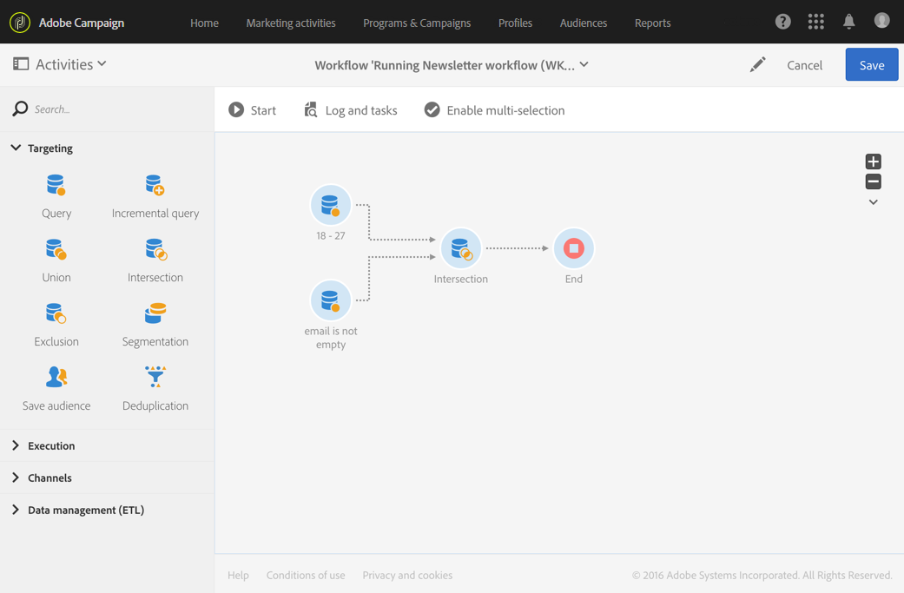

# 交集{#intersection}

## 说明 {#description}

利用 **[!UICONTROL Intersection]** 活动，可仅在活动中保留不同集客群体的共有元素。

## 使用环境 {#context-of-use}

**[!UICONTROL Intersection]** 活动通常用于对来自集客过渡的群体进行进一步的筛选。

## 配置 {#configuration}

1. 将 **[!UICONTROL Intersection]** 活动拖放到工作流中。
1. 将其连接至其前方的其他活动，例如查询。
1. 选择活动，然后使用所显示快速操作中的  按钮将其打开。
1. 选择 **[!UICONTROL Reconciliation type]**：

   * **[!UICONTROL Keys only]**：默认模式。 当来自不同集客过渡的元素具有相同的键值时，该活动只保留一个元素。
   * **[!UICONTROL All shared columns]**：根据集客过渡共有的列协调数据。 因此，您必须选择用作比较基础的主集。 如果集客群体定向维度不同，则可以使用此选项。
   * **[!UICONTROL A selection of columns]**：选择此选项可定义要应用数据协调之列的列表。 必须先选择主集（包含源数据的集），然后指定用于相交的字段。

1. 如果您希望仅保留所有集客过渡中的附加数据，请勾选 **[!UICONTROL Use common additional data only]** 方框。
1. 如果需要，可以管理活动的[过渡](../../automating/using/activity-properties.md)，以访问叫客群体的高级选项。
1. 确认活动的配置并保存工作流。

## 示例 {#example}

下方的示例展示了两个查询活动之间的交集。 本例中，将其用于查看 Adobe Campaign 数据库并检索年龄在 18 到 27 岁之间且已提供了电子邮件地址的轮廓。

