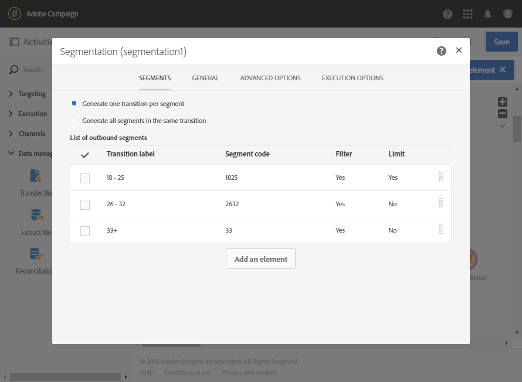

# 根据年龄组进行细分 {#segmentation-age-groups}

以下示例显示了根据年龄组对数据库用户档案进行分段的情况。

该工作流旨在为每个年龄组发送特定的电子邮件。 考虑到此工作流是测试营销策划的一部分，每个区段最多只能包含 100 个随机选择的轮廓，以便使用受限且具有代表性的受众。

工作流由以下元素组成：

* 用于指定工作流执行日期的[调度程序活动](../../automating/using/segmentation.md)。
* [查询](../../automating/using/query.md)活动，用于定向已输入生日和电子邮件地址的用户档案。
* 用于创建3个区段的[分段](../../automating/using/segmentation.md)活动，这些区段将划分不同的叫客过渡：18-25岁、26-32岁以及32岁以上的用户档案。 区段根据以下参数进行定义：

  

  * 用于定义区段年龄组的年龄过滤器

    

  * 链接到 **[!UICONTROL Maximum size]** 限制为 100 的 **[!UICONTROL Random sampling]** 类型限制

    

* 每个区段的[电子邮件投放](../../automating/using/email-delivery.md)活动。
