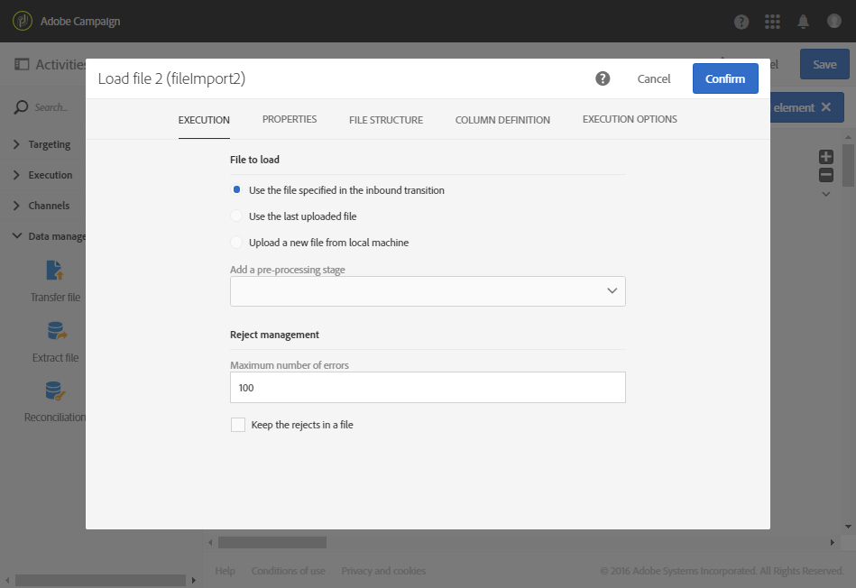

# 根据自动文件下载更新数据 {#updating-data-automatic-file-download}

加载文件活动主要用于从传输文件活动构造数据，以便将其集成到现有数据中。

下方的示例展示了通过依次进行传输文件活动和更新数据活动，自动下载的加载文件活动的结果。 此工作流旨在使用新轮廓扩充 Adobe Campaign 数据库，或使用从导入文件取回的数据来更新现有轮廓。

要构建工作流，请执行以下步骤：

1. 将[传输文件](../../automating/using/transfer-file.md)活动拖放到工作流中。
1. 选择活动，然后使用所显示快速操作中的  按钮将其打开。
1. 以某种方式配置活动，以便它可以取回您想要的文件。 在 **[!UICONTROL Protocol]** 选项卡中，选择 **SFTP**。
1. 选择 **Use connection parameters defined in an external account** 选项。
1. 输入外部帐户的名称。
1. 输入&#x200B;**远程服务器上的文件路径**。

   

1. 确认您的活动。
1. 将[加载文件](../../automating/using/load-file.md)活动拖放到您的工作流中，并将其放在&#x200B;**[!UICONTROL Transfer file]**&#x200B;活动之后。
1. 选择活动，然后使用所显示快速操作中的  按钮将其打开。
1. 在 **[!UICONTROL File to load]** 选项卡的 **[!UICONTROL Execution]** 中，勾选 **[!UICONTROL Use the file specified in the inbound transition]** 选项。

   

1. 按照之前指定的方式配置活动。
1. 将[更新数据](../../automating/using/update-data.md)活动拖放到您的工作流中，并将其放在&#x200B;**[!UICONTROL Load file]**&#x200B;活动之后，然后对其进行配置。

启动工作流后，将提取来自上传文件的数据，然后将其用于扩充 Adobe Campaign 数据库。
