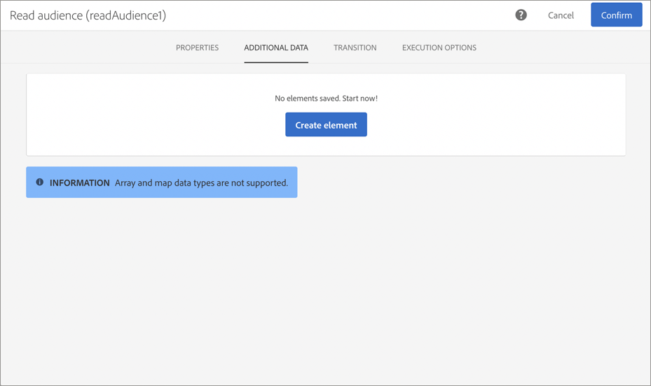

# 使用 Adobe Experience Platform 属性个性化营销活动 {#personalizing-campaigns-using-aep-attributes}

>[!IMPORTANT]
>
>Audience Destinations服务当前为测试版，可能会频繁更新，恕不另行通知。 客户需要在Azure上托管（目前为测试版，仅限北美地区使用）才能访问这些功能。 如果您希望访问，请联系Adobe客户关怀。
>
>使用Adobe Experience Platform中的上下文数据的&#x200B;**推送**&#x200B;和&#x200B;**应用程序内**&#x200B;渠道尚不可用于个性化。

为您的工作流配置了[Adobe Experience Platform受众](../../integrating/using/aep-about-audience-destinations-service.md)后，您可以使用专门存在于Experience Data Model (XDM)中的用户档案属性对消息进行个性化设置。

为此，您必须将这些属性添加到&#x200B;**[!UICONTROL Read audience]**&#x200B;活动中：

1. 打开&#x200B;**[!UICONTROL Read audience]**&#x200B;活动。 在&#x200B;**[!UICONTROL Additional data]**&#x200B;选项卡中，单击&#x200B;**[!UICONTROL Create element]**&#x200B;按钮。

   请注意，**[!UICONTROL Additional data]**&#x200B;选项卡仅在选择Adobe Experience Platform受众后可用。

   

   >[!NOTE]
   >
   >此功能不支持数组和映射数据类型。 此外，选取器中只显示合并架构中的数据。

1. 从列表中选择所需的XDM字段，然后单击&#x200B;**[!UICONTROL Confirm]**。

   

1. 单击&#x200B;**[!UICONTROL Add]**&#x200B;按钮以将其添加到其他数据列表。

   

1. 对要添加到工作流中的每个XDM字段重复这些步骤。

   >[!NOTE]
   >
   >在&#x200B;**[!UICONTROL Read audience]**&#x200B;活动中最多可添加20个XDM字段。

1. 添加所有字段后，单击&#x200B;**[!UICONTROL Confirm]**&#x200B;按钮以保存更改。 现在即可使用这些功能对投放进行个性化。

有关如何创建和个性化投放的更多信息，请参阅Campaign Standard文档：

* [了解通信渠道](../../channels/using/get-started-communication-channels.md)
* [关于渠道活动](../../automating/using/about-channel-activities.md)
* [个性化投放](../../designing/using/personalization.md)
