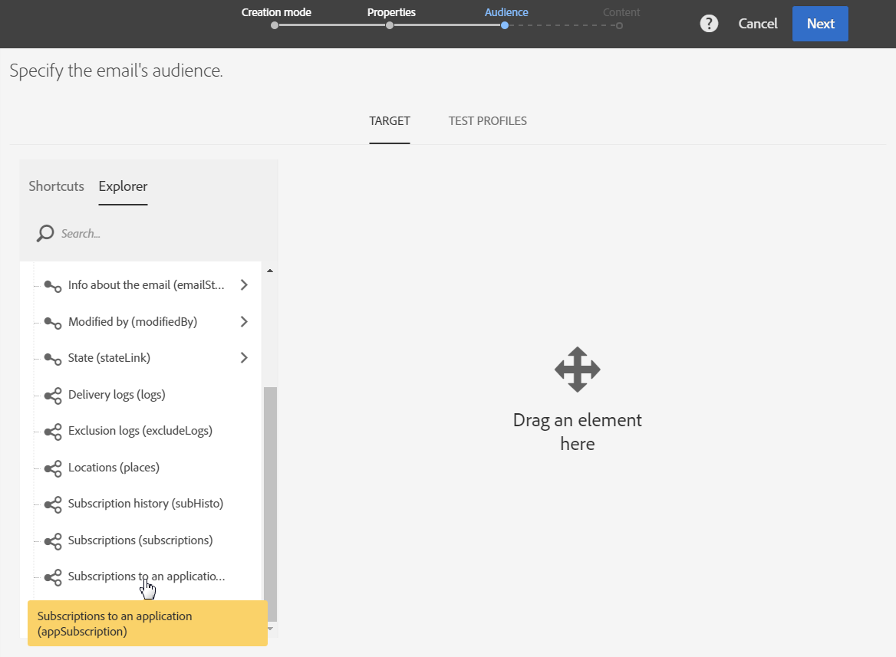
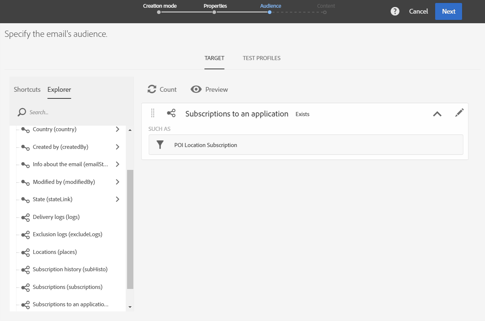

# 使用兴趣点数据个性化 Campaign 消息{#personalizing-campaign-messages-with-point-of-interest-data}

在Adobe Campaign中，您可以使用从移动应用程序的订阅者那里收集的Points of Interest数据，向他们发送个性化的营销消息，如电子邮件。

您只能对Point of Interest数据进行标准投放。 [事务性消息](../../channels/using/getting-started-with-transactional-msg.md)无法使用位置数据。

你最早能做出反应大约需要10分钟。

在这种情况下，您决定向过去两周内访问您波士顿商店的所有订阅者发送电子邮件。

1. 创建电子邮件营销活动。
1. 定义投放的受众时，将&#x200B;**[!UICONTROL Subscriptions to an application]**&#x200B;元素拖放到工作区中。

   

   有关管理受众的详情，请参见[定义受众](../../audiences/using/creating-audiences.md)一节。

1. 在&#x200B;**[!UICONTROL Add a rule - Profile/Subscriptions to an application]**&#x200B;窗口中，将&#x200B;**[!UICONTROL POI Location Subscription]**&#x200B;元素拖放到工作区中。

   

1. 在&#x200B;**[!UICONTROL Add a rule - POI Location Subscription]**&#x200B;窗口中，输入要使用的目标点标签。

   

1. 在 **[!UICONTROL Filter type]** 字段中，选择 **[!UICONTROL Relative]**。
1. 选中&#x200B;**[!UICONTROL Preceding days]**&#x200B;选项并在相应的字段中输入&#x200B;**[!UICONTROL 15]**。
1. 定义用户必须已访问目标点的次数。
1. 单击&#x200B;**[!UICONTROL Confirm]**&#x200B;以保存受众。

   

1. 向电子邮件添加内容。

   

1. 确认创建活动以查看电子邮件的仪表板。
1. 发送您的消息。

包含10%折扣选件的电子邮件将发送给满足以下条件的订阅者：

* 在过去的两周内至少去过你位于波士顿的店铺一次。
* 在访问期间至少将移动设备应用程序置于前台一次。

**相关主题：**

* [创建电子邮件](../../channels/using/creating-an-email.md)
* [定义内容](../../designing/using/personalization.md#example-email-personalization)
* [发送消息](../../sending/using/confirming-the-send.md)
