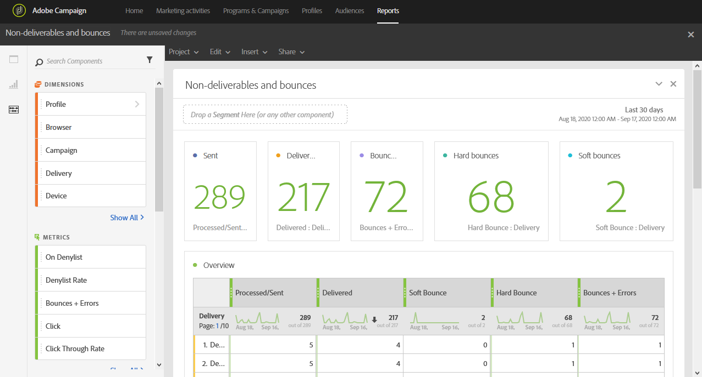

# 无法投放项和退回{#non-deliverables-and-bounces}

**[!UICONTROL Non-deliverables and bounces]**&#x200B;报告提供了有关投放期间遇到的所有错误的详细信息。

**[!UICONTROL Overview]**&#x200B;表包含与每次投放可能遇到的错误有关的可用数据，例如：

* **已处理/已发送**：已发送的电子邮件数。
* **已传递**：已传递的电子邮件数。
* **软退回**：临时错误的总数，如收件箱已满。
* **硬退回**：永久错误的总数，如电子邮件地址错误。
* **退回+错误**：无法传递的消息数。

**按域**&#x200B;划分表列出了每个收件人的域的跳出次数。
